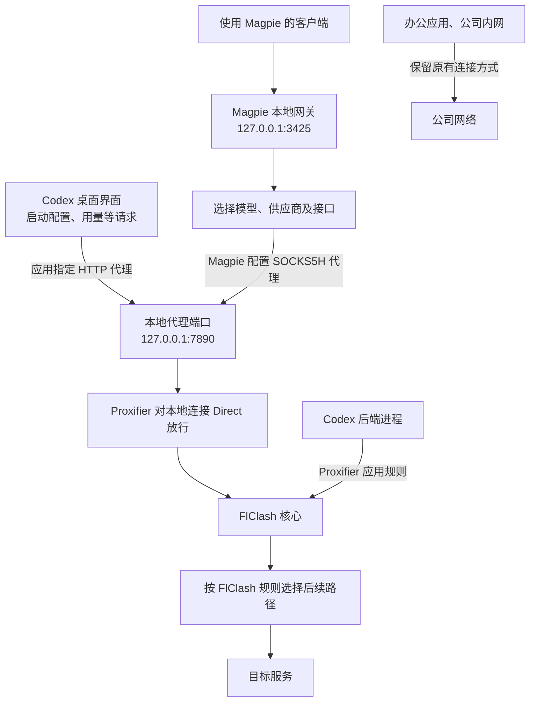
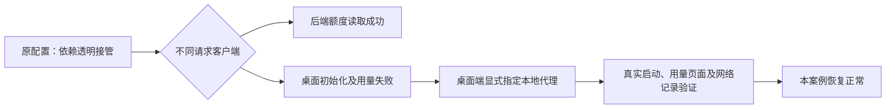
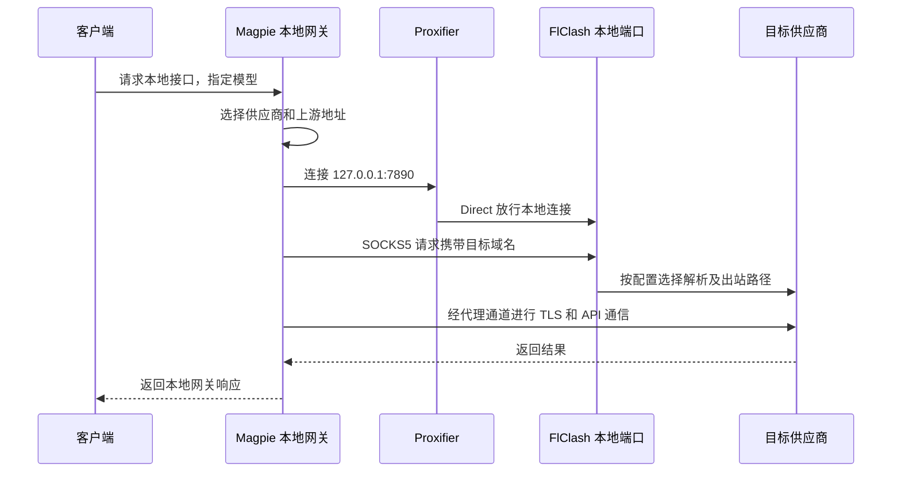
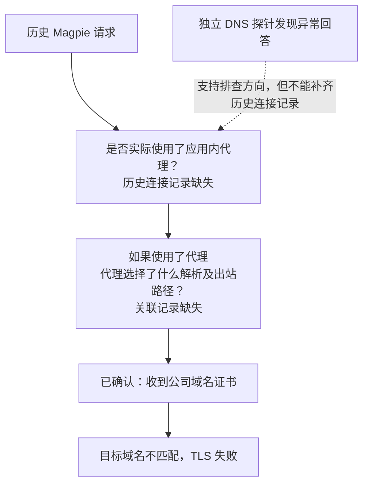
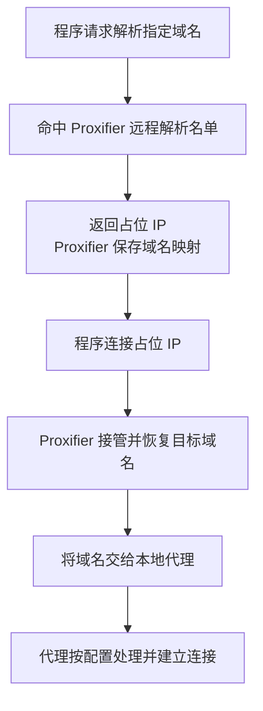

<span id="公司网络下的应用级代理codex-与-magpie-排障教程"></span>

> 目标：关闭 TUN 和 Windows 系统代理，让指定应用使用本地代理，同时保留办公网络的原有连接方式。
>
> 本文是脱敏案例与配置教程。个人目录、公司名称、公司域名、实际内网地址、第三方供应商地址和账户标识均已移除。端口与路径为示例，请替换为本机实际值。

相关笔记：[[Codex Claude 软件级代理设置教程]]（Proxifier 按进程代理与 DNS 代理解析）、[[ChatGPT Windows 升级后 Proxifier 网络异常排查]]（DNS 与 IP 泄漏防护模式）、[[Proxifier与Codex浏览器控制-原理与排错]]（Proxifier 规则排错方法）。

## 1. 先明确：可用方案不等于完整根因

本案例涉及两个应用，但它们的证据强度不同，不能写成两项均已查明根因的修复。

| 应用 | 原有现象 | 已验证的可用方式 | 尚未证实的部分 |
| --- | --- | --- | --- |
| Codex | 启动等待约一分钟，用量页面失败；后端额度接口却能成功 | 桌面端显式指定本地 HTTP 代理；保留 Proxifier 处理后端连接。真实用量页面恢复，相关接口返回 200 | 原透明代理路径具体为什么失败；是否涉及进程启动方式、网络组件或代理兼容性 |
| Magpie | 请求上游时出现公司域名证书与供应商域名不匹配 | 使用 Magpie 已配置的本地 SOCKS5H 代理，真实请求正常 | 历史失败请求是否实际使用了该代理，以及代理后续选择了什么解析和出站路径 |

特别注意：本案例的 Magpie 原本已经设置应用内代理。不能把它的恢复归功于后来新增的 Proxifier 域名规则。历史记录中，新增规则之前也有成功请求。

## 2. 几个容易混淆的概念

| 名称 | 作用 | 不代表什么 |
| --- | --- | --- |
| Magpie 本地网关／路由 | 接收客户端请求，选择模型、供应商和上游接口 | 不等于网络代理，也不保证上游连接走代理 |
| 应用内代理 | 应用主动把连接交给指定代理地址 | 不要求开启 Windows 系统代理 |
| Windows 系统代理 | 为遵循系统设置的程序提供代理配置 | 不保证覆盖所有程序 |
| Proxifier | 按应用、目标等规则接管连接 | `Direct` 不一定表示访问公网；也可能是放行到本机代理端口 |
| FlClash 核心 | 接收代理连接，再按规则选择后续连接路径 | 关闭系统代理和 TUN，不等于关闭核心或本地代理监听 |
| TUN | 在虚拟网卡层处理流量 | 不是本教程所需的前提 |

本文使用以下示例值：

| 项目 | 示例 |
| --- | --- |
| FlClash 本地混合代理端口 | `127.0.0.1:7890`，需实际支持 HTTP 和 SOCKS5 |
| Magpie 本地网关 | `http://127.0.0.1:3425` |
| 脱敏后的供应商域名 | `api.provider.example`，仅为示意，不能直接使用 |
| 脱敏后的公司域名 | `corp.example`，仅为示意，不能直接使用 |

## 3. 总体连接图



这张图描述应用级代理的分工。实际哪些流量经过某条规则，应以运行日志为准；不能只看配置界面中是否勾选了代理。

## 4. 方案一：为 Codex 桌面端单独指定代理

### 4.1 为什么选择这个方案

案例中，开启系统代理可以改善 Codex，但会扩大影响范围。既然本地代理端口可用，就尝试让 Codex 桌面端自己使用该端口，而不改变其他应用的系统代理设置。

排查还发现：桌面界面的启动配置、用量请求与后端额度读取使用不同的客户端路径。后端接口成功，只能证明后端路径可用，不能替代界面验收。



方案有效，不代表已经证明某个软件存在固有缺陷。本案例的成功测试还改变了启动入口，未完成同一入口移除代理参数的完整反向对照，因此更不能过度归因。

### 4.2 配置步骤

1. 确认 FlClash 核心运行，本地端口可用；保持 TUN 和 Windows 系统代理关闭。
2. 找到实际 Codex 桌面可执行文件。案例版本使用 `ChatGPT.exe`，不要误选后端命令行程序 `codex.exe`；不同版本应以本机安装内容为准。
3. 新建一个独立 Windows 快捷方式，保留原入口用于回退。
4. 在快捷方式的目标中添加应用级代理参数。下面的路径和端口都需要替换：

```text
"C:\Path\To\Codex\ChatGPT.exe" --proxy-server=http://127.0.0.1:7890
```

如果 Codex 内部还需要访问本机和公司资源，可以按实际情况添加绕过名单：

```text
--proxy-bypass-list="<local>;localhost;127.0.0.1;[::1];10.0.0.0/8;172.16.0.0/12;192.168.0.0/16;corp.example;*.corp.example"
```

`corp.example` 必须换成实际需要直连的公司域名，或者删除该示例项。私网网段是通用地址范围，并不代表已覆盖全部办公服务；不要仅凭网段名单判断域名形式的公司服务一定会绕过代理。

5. 完全退出旧 Codex 实例，再从新入口启动。已有实例可能接收后续启动请求，不能假定每次点击都应用了新参数。
6. 测试真实用量页面、启动过程和对话功能。

Electron 官方支持 `--proxy-server` 和 `--proxy-bypass-list`，前者覆盖应用的系统代理选择，作用于其支持的 HTTP、HTTPS 和 WebSocket 请求，并不自动覆盖独立后端的所有网络库。[官方参数说明](https://www.electronjs.org/docs/latest/api/command-line-switches#--proxy-serveraddressport)

### 4.3 为什么 HTTPS 可以使用 HTTP 代理地址

`http://127.0.0.1:7890` 描述客户端与本地代理交互的协议，不表示把目标 HTTPS 请求降级为明文 HTTP。

典型流程是：客户端向代理请求建立到 `目标域名:443` 的 CONNECT 隧道，再通过隧道与目标服务进行 TLS 握手。证书仍须与目标域名匹配。

### 4.4 验收结果应该怎么写

本案例中，程序统计的完整界面启动从约 70 秒降到约 13 秒；用户感知可用时间更短，两者统计口径不同。网络记录确认初始化接口和用量接口返回 HTTP 200，用量请求响应头耗时约为半秒以内。

这类结果应表述为“该配置在本环境下验证可用”，不要表述为“所有 Codex 慢启动都由 Proxifier 导致”。

## 5. 方案二：Magpie 本地路由加应用内代理

### 5.1 两层配置分别负责什么



本地网关地址告诉客户端“把请求交给 Magpie”。Magpie 中的代理地址告诉 Magpie“连接供应商时怎样出去”。两项可以同时存在，互不替代。

### 5.2 配置步骤

1. 客户端继续使用 Magpie 提供的本地网关地址。
2. 在 Magpie 的代理设置中确认本地代理，例如：

```text
socks5h://127.0.0.1:7890
```

3. 保存设置，并按当前版本要求重新加载相关连接或重启 Magpie。
4. 在 Proxifier 中让到本机代理端口的连接直连放行。
5. 发起一条真实 Magpie 请求，同时核对 Magpie 的结果及连接日志。

本案例本来就配置了 SOCKS5H，因此这里是对已确认配置的说明，不是一次新补上的修复。不能为了套用教程再重复添加代理层。

`socks5h` 通常表达由代理处理目标主机名的意图；客户端支持情况应按其实现确认。以 curl 为例，官方明确区分 SOCKS5 本地解析与 SOCKS5 hostname 代理解析。[curl 官方手册](https://curl.se/docs/manpage.html#--socks5-hostname)

### 5.3 对历史证书错误能下什么结论

脱敏后的错误形态为：

```text
certificate is valid for *.corp.example, not api.provider.example
```

它证明这次 TLS 握手收到的证书不适用于目标域名。它本身不能证明：

- Magpie 当时没有使用代理；
- 错误一定发生在公司 DNS 服务器；
- 错误一定由 Proxifier 或 FlClash 产生。

本案例还通过独立探针发现：企业网络的 DNS 路径能把供应商域名返回为一个公司内网地址，该地址提供公司证书。但独立探针不是原始 Magpie 请求，不能直接把两条证据拼成已证实的故障链。



## 6. 应用内代理与 Proxifier 会不会重复代理

只要到本地代理的连接被正确放行，就不会重复。

```text
应用主动连接 127.0.0.1:7890
    → Proxifier 判断：本地连接，Direct
    → 直接交给 FlClash
    → FlClash 按规则连接目标
```

这里 `Direct` 的目的地是本机 FlClash，不是供应商公网地址。案例中的 Magpie 也可能命中更早的应用直连规则；只要连接目标已经是 `127.0.0.1:7890`，同样是在放行本地代理连接。

可参考下面的规则分工，按现有环境合并，不要整份覆盖原配置：

| 优先顺序示意 | 匹配项 | 动作 | 目的 |
| --- | --- | --- | --- |
| 靠前 | FlClash 核心进程 | Direct | 避免代理核心被送回自身 |
| 靠前 | `localhost`、`127.0.0.1`、`::1` | Direct | 放行本地网关和本地代理 |
| 按现有策略 | 公司资源与办公应用 | Direct | 保留办公连接 |
| 按需 | 不使用自身代理的 Codex 后端等进程 | 本地 SOCKS5 代理 | 接管这些进程的连接 |
| 最后 | 未匹配流量 | 保留原动作 | 避免意外扩大代理范围 |

如果某个需要代理的公网域名可能被错误解析成私网 IP，可使用“指定应用＋指定公网域名”的规则，并根据需要放在私网直连规则之前。这仅适用于需要 Proxifier 接管的连接，不是 Magpie 已有应用内代理的必需步骤。

## 7. DNS 到底在哪里解析

### 7.1 路径 A：应用主动使用代理


这种路径不要求应用先通过公司 DNS 取得目标 IP。但“域名交给 FlClash”不等于“必然由境外节点解析”，也不等于“公司 DNS 已被修复”。FlClash 仍可能按其配置进行本地解析或选择直连，必须检查真实路由。

### 7.2 路径 B：由 Proxifier 接管并代理解析

对于没有自身代理配置的程序，可以按需在 Proxifier 中使用“仅以下名称通过代理解析”，只列需要代理的公网域名。



占位 IP 不是网站真实地址。Proxifier 官方说明，代理解析需要占位地址，基于真实目标 IP 的规则在这种模式下会受到限制；“仅以下名称”之外的域名继续本地解析。[Proxifier DNS 文档](https://www.proxifier.com/docs/win-v4/dns.html)

配置时注意：

- 不要为了修复少数公网域名，把公司域名或所有域名都放进远程解析范围。
- DNS 名单不是简单的“仅对某一应用生效”开关，其他被 Proxifier 处理的程序访问同一域名时也可能受影响。
- 不要为了放行 localhost 就机械地把整个 `127.0.0.0/8` 加到高优先级直连规则，那里也可能包含代理工具的占位地址；按实际日志检查匹配行为。
- 新增域名规则只帮助实际经过 Proxifier 接管的上游连接；已经连接到本地代理端口的请求不靠它决定供应商路由。

### 7.3 “使用目标主机名”高级选项是什么

Proxifier 的“在代理请求中使用目标主机名（如果可用）”选项，让代理请求在已知域名时优先携带主机名。若程序直接连接 IP、Proxifier 不知道对应域名，该选项不能凭空恢复域名。[高级代理设置说明](https://www.proxifier.com/docs/win-v4/proxy-advanced.html)

它不是 DNS 防篡改开关，也不能单独证明错误解析问题已经解决。本案例无法把它的效果与其他改动严格分离。

## 8. 怎样验证，才不会误判

建议按下面顺序记录，尽量一次只改变一个变量：

1. 确认 TUN 关闭、系统代理关闭、本地代理核心运行。
2. 确认应用实际启动参数或有效代理配置，而不只看快捷方式名称。
3. 完全退出并重新启动目标应用，避免复用旧连接或旧实例。
4. 测试用户原来失败的功能：Codex 用量页面、Magpie 原模型和供应商请求。
5. 将同一时段的应用错误、代理入口连接、FlClash 出站记录关联起来。
6. 检查常用办公业务仍可用。保留直连规则不等于已经验收了所有办公业务。

### 可选的无凭据网络探针

以下仅测试到公开站点的传输，不登录账户、不调用付费 API：

```powershell
# 测试本地 HTTP 代理；用环回目标避免 NO_PROXY 对公网目标的影响
curl.exe --noproxy "localhost,127.0.0.1" --proxy "http://127.0.0.1:7890" --head --connect-timeout 5 --max-time 15 "https://chatgpt.com/"

# 测试由 SOCKS5 代理处理目标域名
curl.exe --noproxy "localhost,127.0.0.1" --proxy "socks5h://127.0.0.1:7890" --head --connect-timeout 5 --max-time 15 "https://chatgpt.com/"
```

注意：curl 也可能受到现有 Proxifier 规则影响，需结合日志确认。公开页面对未登录探针返回 403，不能据此认定应用登录失败；完成 TLS 也不能证明用量功能正常。

| 看到的证据 | 可以说明什么 | 不能说明什么 |
| --- | --- | --- |
| TCP 或 TLS 连接成功 | 某条传输路径可用 | 登录、权限或业务接口一定成功 |
| 后端额度接口成功 | 后端对应请求可用 | 桌面用量界面一定正常 |
| 真实用量页面正常且请求 200 | 该功能在当前状态下通过 | 历史失败的底层原因已查清 |
| 独立 DNS 查询返回错误地址 | 该 DNS 查询路径异常 | 原应用一定使用了这个回答 |
| 改名 curl 探针成功 | 对应该进程名和探针配置的路径可用 | 真实应用的代理、TLS、协议和鉴权路径相同 |
| 重启后恢复 | 重启后的状态可用 | 一定是软件缓存 bug |

## 9. 快捷方式、更新与回退

- `.lnk` 快捷方式采用绝对目标路径时，可以移动到桌面或其他文件夹，代理参数会保留。
- 应用更新后，带版本号的安装目录可能变化；若入口失效，应重新核对可执行文件路径。
- 要回退 Codex 应用代理，使用保留的原入口，或删除新入口中的代理参数，然后完整重启应用。不要仅改快捷方式就认为运行中的实例已经切换。
- Magpie 原有代理已经工作时，不必重复叠加其他代理配置。若需回退，先记录原代理值，再按该版本支持的方法保存并重载。
- Proxifier 回退只撤销本次新增规则、DNS 项和选项，不覆盖之后的其他修改。
- 日常入口不要保留 `--log-net-log` 等诊断记录参数。修改启动参数不会停止已运行实例的记录；旧实例正常退出后才停止。诊断结束后按需要关闭详细日志。

## 10. 脱敏与经验记录

对外分享教程或故障报告时，保留产品名称、协议、示例规则和必要时序即可。原始网络记录可能包含完整 URL、设备信息或会话相关字段，不要把原始日志直接附在知识库教程中。

本案例最重要的经验是：

- 应用内部路由、应用代理、系统代理和透明接管是不同层次。
- 可用方案可以从已有成功路径缩小作用范围得到，不必先断言某个软件存在 bug。
- 验证必须覆盖真实应用的失败功能；探针配置不同，就不能替代真实请求。
- 历史配置和关联日志缺失时，应保留根因未知，而不是用当前配置倒推过去。
- 目标是形成可验证、可回退、影响范围明确的连接方案，同时诚实记录还没查明的部分。

## 参考链接

- [Electron：命令行参数（`--proxy-server`、`--proxy-bypass-list`）](https://www.electronjs.org/docs/latest/api/command-line-switches#--proxy-serveraddressport)
- [curl：`--socks5-hostname` 与 SOCKS5 解析位置](https://curl.se/docs/manpage.html#--socks5-hostname)
- [Proxifier：Name Resolution（DNS 代理解析与占位地址）](https://www.proxifier.com/docs/win-v4/dns.html)
- [Proxifier：Advanced（在代理请求中使用目标主机名）](https://www.proxifier.com/docs/win-v4/proxy-advanced.html)
- [Magpie：本地网关与代理设置](https://github.com/yetone/magpie)

## 发布与隐私

本文设置了 `publish: true`，只记录可公开复用的配置和排障方法。个人目录、公司名称、公司域名、内网地址、第三方供应商地址和账户标识均已替换为示例；端口与路径为示例值。原始网络日志不随本文公开。
